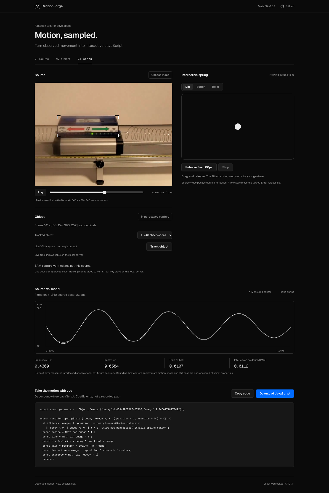

# MotionForge

**Motion, sampled.** Turn observed object movement into reusable, interactive JavaScript springs.

Built for the [Meta Global AI Developer Hackathon 2026](https://dev.meta.ai/events/global-hackathon): Indie Developer track, “Push the Frontier” problem statement. An independent prototype, not an official Meta product.

**[Watch the 67-second demo](https://youtu.be/jpR7Zbpi3nQ)**

Meta SAM 3.1 tracks an object in your video. MotionForge fits its bounding-box centers to a damped oscillation, then exports a spring that responds to **new** positions and velocities. It is not a video player or a replay of recorded coordinates.

**Pipeline:** Video → box-seeded SAM 3.1 → source-indexed measurements → deterministic oscillation fit → interactive JavaScript.

Meta SAM 3.1 supplies tracked boxes. MotionForge associates them with source-frame timestamps, measures bounding-box centers, and fits a deterministic damped oscillation. No custom neural training is involved.

## Preview



Screenshot from the validated live-SAM workflow. Oscillator footage by [Pieter Kuiper](https://commons.wikimedia.org/wiki/File:Oscillatory_motion_acceleration.ogv), used with attribution.

## Run locally

Requires Node.js 22.9+ and `ffmpeg` / `ffprobe` on your PATH. No npm dependencies or GPU are required.

Set `MODEL_API_KEY` in an ignored `.env.local`, using `.env.example` as the template. The key must have access to Meta's SAM API. Never put it in browser code or a public repository.

```sh
npm start
```

Open `http://127.0.0.1:4173`. To use another port:

```sh
npm start -- --port 4174
```

This is a **local tool**, not an authenticated public service. Do not expose its HTTP server to the internet. No hosted deployment is provided.

## Workflow

1. Choose a video. The local server probes it; the browser independently hashes its bytes.
2. Pause on a source frame and draw a rectangle around one object.
3. Choose **Track object**. The server uploads the clip to Meta and requests box-seeded SAM 3.1 tracking.
4. Inspect the tracked box and the measured-versus-fitted curve. Unsupported motion is rejected.
5. Drag and release a dot, button, or toast. Try different initial conditions without replaying the source video.
6. Copy or download `motionforge-spring.mjs`, a dependency-free module exporting `parameters`, `springState`, and `sample`.

Saved capture JSON can also be imported alongside its matching source video. The interface labels this as a saved capture, not a live request. A missing API key does not prevent that offline workflow.

## Supported input

- MP4 or MOV, 1 byte to 25 MiB.
- 2–10 seconds, 40–600 source frames, up to 1920 × 1080.
- H.264, HEVC, or MPEG-4 video; browser decoding support is also required. H.264 is recommended.
- One clear object, fixed camera, predominantly one-axis oscillation with enough visible cycles.

Stationary objects, cuts, camera movement, collisions, arbitrary trajectories, and reliable physical reconstruction are outside the supported motion family. Rotated or otherwise incompatible browser/probe dimensions are rejected.

## What the model means

The fitted curve has the form:

```text
offset + exp(-decay × t) × (a × cos(omega × t) + b × sin(omega × t))
```

The export contains fitted coefficients and reusable equations, not the tracked path. Bounding-box centers are screen-space measurements. They do not reveal physical mass or stiffness; `mass: 1` is a simulation convention.

Fit acceptance includes interleaved held-out observations. That error measures agreement within the observed clip, **not future predictive accuracy**.

The capability spike has passed on **one real physical oscillator clip**. This does not establish arbitrary-video reliability.

## Verified demo scope

- **Tracking:** 240/240 source-indexed observations from one physical oscillator clip.
- **Fitting:** the unchanged fitter accepted the capture, with approximately 1.12% interleaved holdout NRMSE. This measures agreement within the observed clip, not future predictive accuracy.
- **Interaction and export:** native browser checks verified drag/release, Stop/restart, Dot/Button/Toast targets, and an actual executable JavaScript download.

The video shows a live SAM run followed by a clearly labeled replay of its saved response. The replay makes no new inference.

## Safety and privacy

- Source SHA256, dimensions, schema, object identity, and source timestamps gate fitting and export.
- Meta credentials stay on the server. Tracking is explicit, with no automatic retries.
- One tracking operation runs at a time. Three uncached operations per minute reserve up to six provider HTTP requests.
- Provider authentication or rate-limit failures disable further live tracking until the server restarts.
- Videos remain on the local server until tracking sends them to Meta. Use public or approved footage and review Meta's applicable data terms.
- Local uploads persist in ignored `uploads/`. Captures and generated artifacts belong in ignored `results/` or `captures/`, never source control.

## Verification

```sh
npm test
```

Tests cover numerical fitting, independent physics integration, SAM parsing, capture validation, export, local HTTP boundaries, and browser-state guards. Unit transport doubles are not evidence of a live Meta call.

The earlier diagnostic viewer remains available through `node spike/serve-viewer.mjs`; it also defaults to port 4173, so do not run both servers on that port.

## Demo footage and third-party notices

Physical oscillator footage: [“Oscillatory motion acceleration” by Pieter Kuiper](https://commons.wikimedia.org/wiki/File:Oscillatory_motion_acceleration.ogv). Its source page permits reuse, derivatives, and commercial use with attribution to **Pieter Kuiper**. The local validation clip trims seconds 6–14, removes audio, and converts to H.264 at 640 × 480, 30 fps. Source videos and raw tracking captures are not included in this repository. The README screenshot contains an attributed still from the validation clip. Retain this credit in any published demonstration using that footage.

Geist fonts are by Vercel in collaboration with basement.studio, distributed under the [SIL Open Font License](web/fonts/OFL.txt). UI primitive styles and the GitHub icon include adaptations from shadcn/ui and Motion Primitives; their MIT notices are retained in [THIRD_PARTY_NOTICES.txt](THIRD_PARTY_NOTICES.txt).

Original MotionForge code is licensed under MIT ([LICENSE](LICENSE)). Third-party assets retain their separate licenses and notices. See [CONTRIBUTING.md](CONTRIBUTING.md) and [CODE_OF_CONDUCT.md](CODE_OF_CONDUCT.md).
